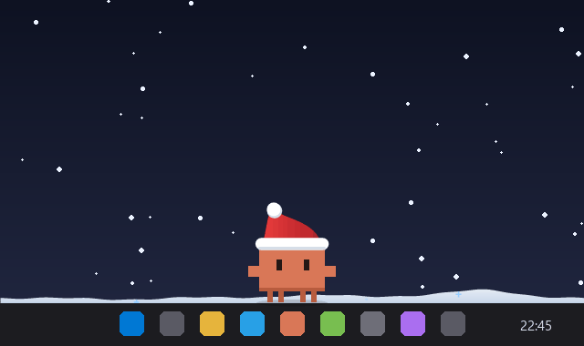
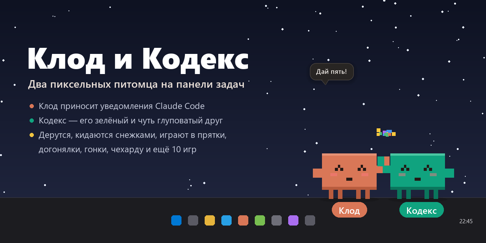
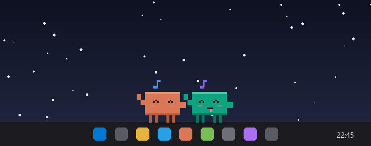
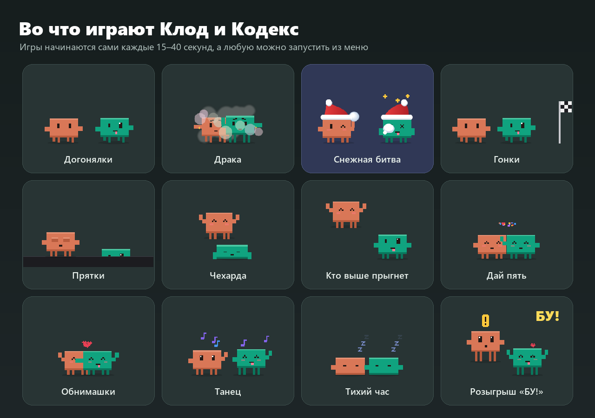
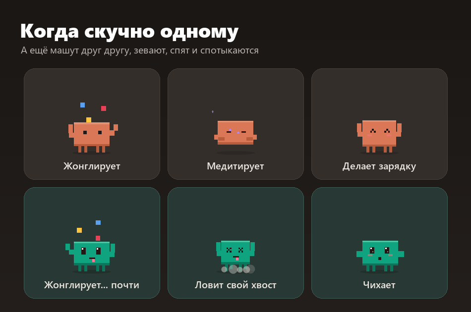

# Clawdling


Маленький пиксельный питомец для Windows, который живёт на панели задач, гуляет по экрану и приносит уведомления от **Claude Code**.

*A tiny pixel desktop pet for Windows that lives on your taskbar, wanders around the screen and pops up with Claude Code notifications. English summary below.*

- Один `.exe` на ~120 КБ, без установки и зависимостей (используется .NET Framework 4.8, который уже есть в Windows 10/11)
- Работает в фоне, ~10 МБ памяти, почти не грузит процессор
- Прячется, когда открыто полноэкранное приложение (игра, видео) на его мониторе

## Возможности

<p align="center"></p>

**Живёт своей жизнью.** Ходит и бегает по панели задач, сидит, засыпает (Zzz), зевает, танцует, машет, думает, следит глазами за курсором. Забирается на края экрана, запрыгивает на окна и катается на них, когда ты их двигаешь. Иногда ныряет в панель задач и выглядывает оттуда.

**Эмоции.** Радость, смех, влюблённость, удивление, грусть со слезой, злость, головокружение со звёздочками, подмигивание, сонливость и т.д.


**Можно трогать.**
- Зажми и перетащи — он болтает лапками; отпусти с размаху — полетит и запрыгает как мячик: отскакивает от пола, окон, краёв экрана и потолка
- Кинь Клода в Кодекса (или наоборот) — собьёт его как кеглю, тот тоже отлетит, обидится и может погнаться за обидчиком
- Клик — радуется, много кликов — злится, двойной клик — танцует
- Правый клик — меню

<p align="center"></p>

**Уведомления Claude Code.**
- Claude закончил работу → Клод выпрыгивает с конфетти и пузырём «Готово!»
- Claude ждёт ответа/подтверждения → подпрыгивает с «!»
- Запрос разрешения → пузырь с кнопками **Разрешить / Отклонить** прямо на рабочем столе (если не ответить за 45 с — откроется обычный диалог Claude Code)


**Новогодний режим** (меню → «Новогодний режим»)
- Красная шапочка с помпоном, которая болтается при движении
- Снег и сугроб на панели задач
- Клод сам лепит снежки из снега на панели задач и кидается ими в курсор или куда попало
- В него можно кидаться: схвати снег с панели задач, кинь движением мыши, или нажми **Ctrl+Alt+S**. Он может увернуться, а если попасть — обязательно ответит!

<p align="center"></p>

## Клод и Кодекс



**Кодекс — второй питомец.** Зелёный, как GPT, такой же формы, но чуть глуповатый: глаза разного размера, торчит язык, спотыкается на бегу, иногда кидает снежок себе на голову и забывает, зачем пришёл. Каждые 15–40 секунд они с Клодом сами начинают какую-нибудь игру:

<p align="center"></p>

- **Догонялки**: салят друг друга, а прижатый к краю экрана перепрыгивает через догоняющего
- **Драка**: облако пыли со звёздочками, проигравший видит звёздочки и может потребовать реванш
- **Снежная битва** (в новогоднем режиме): разбегаются и закидывают друг друга снежками, уворачиваются, считают попадания
- **Гонки**: «На старт... Марш!» и наперегонки по панели задач. Кодекс иногда спотыкается на полпути
- **Прятки**: один закрывает глаза лапками и считает, другой ныряет в панель задач. Кодекс прячется плохо и выглядывает
- **Кто выше прыгнет**: прыгают по очереди, победитель празднует
- **Повторялка**: один показывает движение, второй повторяет. Кодекс иногда путает и делает что-то своё
- **Чехарда**, **Дай пять**, **Танец**, **Обнимашки** с сердечками
- **Тихий час**: зевают и засыпают рядом, Кодекс храпит
- **Розыгрыш «БУ!»**: Кодекс подкрадывается к спящему Клоду и пугает, а потом убегает от него
- **Перетягивание каната**: тянут верёвку с флажком посередине, проигравший падает носом вперёд
- **Гляделки**: смотрят друг другу в глаза, кто первый моргнёт — проиграл (обычно Кодекс: «Это была муха!»)
- **Камень-ножницы-бумага**: трясут кулачками и показывают знаки над головой, при ничьей переигрывают



**Когда скучно одному**, они жонглируют (Кодекс роняет мячики себе на голову), медитируют в воздухе, делают зарядку, чихают, кружатся, пытаясь поймать свой хвост, и машут друг другу, если оказались рядом.

**Фишки.**
- Меню → «Действия» → «Угостить печенькой»: оба едят печеньки, Кодекс иногда глотает свою целиком и косится на чужую
- **Ctrl+Alt+P** — случайная игра прямо сейчас
- После 23:00 они чаще зевают, засыпают и намекают, что пора спать



Кодекс включается и выключается в меню → «Кодекс», там же в «Играть» можно запустить любую игру. Жонглирование, зарядка и медитация есть в меню → «Действия».

## Установка

1. Скачай `Clawdling.exe` из [Releases](../../releases/latest)
2. Положи куда-нибудь насовсем, например в `%LOCALAPPDATA%\Programs\Clawdling\`
3. Запусти. В трее появится значок; там же «Запускать вместе с Windows»

> Windows SmartScreen может предупредить о неизвестном издателе — exe не подписан. «Подробнее» → «Выполнить в любом случае», либо собери сам (см. ниже).

## Обновления

Начиная с версии 1.4.0 Clawdling обновляется сам. Через минуту после запуска и потом раз в 6 часов он проверяет [последний релиз](../../releases/latest) на GitHub. Если вышла новая версия, Клод скажет об этом, скачает `Clawdling.exe`, проверит его и перезапустится уже обновлённым. Настройки и автозапуск сохраняются.

- Меню → «Обновления»: включить или выключить автообновление, проверить вручную, посмотреть текущую версию
- Exe скачивается только из релизов этого репозитория по HTTPS и перед заменой проверяется: размер, имя сборки и что он сообщает ровно ту версию, что указана в релизе
- Если папка с exe недоступна для записи (например, `Program Files`), обновиться не получится — держи exe в `%LOCALAPPDATA%\Programs\Clawdling\`

## Подключение к Claude Code

Добавь в `%USERPROFILE%\.claude\settings.json` (путь замени на свой; в меню есть пункт «Подключение к Claude Code → Скопировать настройки хуков», он подставит путь сам):

```json
{
  "hooks": {
    "Stop": [{ "hooks": [{ "type": "command", "command": "\"C:/Users/you/AppData/Local/Programs/Clawdling/Clawdling.exe\" hook" }] }],
    "Notification": [{ "hooks": [{ "type": "command", "command": "\"C:/Users/you/AppData/Local/Programs/Clawdling/Clawdling.exe\" hook" }] }],
    "PermissionRequest": [{ "hooks": [{ "type": "command", "command": "\"C:/Users/you/AppData/Local/Programs/Clawdling/Clawdling.exe\" hook", "timeout": 60 }] }]
  }
}
```

`PermissionRequest` — по желанию: с ним разрешения можно давать кнопкой в пузыре.

Если Clawdling не запущен, хук запустит его сам.

### Командная строка

```
Clawdling.exe notify "текст" "заголовок" done|attn|info   — показать уведомление
Clawdling.exe ask "текст"                                 — спросить; выводит allow / deny / none
Clawdling.exe hook                                        — режим хука Claude Code (JSON на stdin)
Clawdling.exe play <игра>                                 — Клод и Кодекс начинают игру:
                                                            tag, fight, snow, race, seek, leap, jump,
                                                            copy, five, hug, dance, nap, prank,
                                                            tug, stare, rps
Clawdling.exe codex '<json>'                              — уведомление от OpenAI Codex CLI (его показывает Кодекс)
Clawdling.exe update                                      — скачать и поставить последнюю версию с GitHub
```

Чтобы Кодекс сообщал о завершении работы OpenAI Codex CLI, добавь в `%USERPROFILE%\.codex\config.toml`:

```toml
notify = ["C:/Users/you/AppData/Local/Programs/Clawdling/Clawdling.exe", "codex"]
```

## Сборка

Нужен только Windows — компилятор C# входит в .NET Framework:

```
build.cmd
```

Готовый файл: `bin\Clawdling.exe`.

Картинки для README генерируются из того же кода отрисовки: `tools\make-assets.cmd` (нужен Python с Pillow).

## English

Clawdling is a lightweight (~120 KB, ~10 MB RAM) desktop pet for Windows 10/11. It walks on the taskbar, climbs screen edges, rides on window title bars, can be dragged and thrown, has a dozen emotions and hides while a fullscreen app is active. A second, slightly goofy pet, Codex (GPT green), plays with Claude: tag, cartoon fights, snowball fights, races, hide-and-seek in the taskbar, high jump, copycat, tug of war, staring contest, rock-paper-scissors, leapfrog, high fives, hugs, dancing, naps and a "boo!" prank (Ctrl+Alt+P starts a random one); thrown pets bounce like rubber balls and knock each other over; they also eat cookies; the exe updates itself from GitHub releases (menu → «Обновления», or `Clawdling.exe update`); on their own they juggle, meditate, stretch, sneeze and spin; it can also show OpenAI Codex CLI notifications (`notify = [".../Clawdling.exe", "codex"]`). Hooked into Claude Code (`Stop`, `Notification`, `PermissionRequest` hooks → `Clawdling.exe hook`) it pops up when Claude finishes, needs your attention or asks for permission (with Allow / Deny buttons). New Year mode adds a Santa hat, snow on the taskbar and snowball fights (grab snow from the taskbar and throw it, or press Ctrl+Alt+S). Build with `build.cmd` (uses the C# compiler that ships with .NET Framework).

---

Неофициальный фанатский проект, не связан с Anthropic. Claude и Claude Code — товарные знаки Anthropic, Codex и GPT — товарные знаки OpenAI.

Лицензия: [MIT](LICENSE) © 2026 LoaderCode
