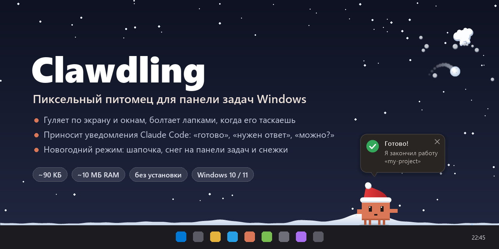
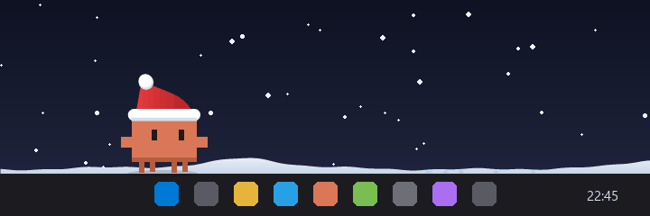
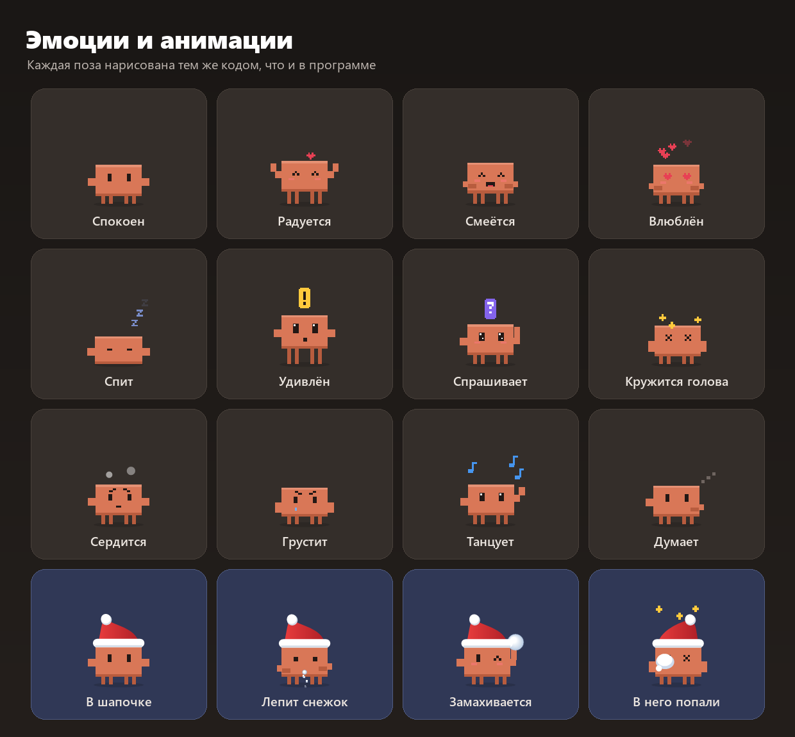
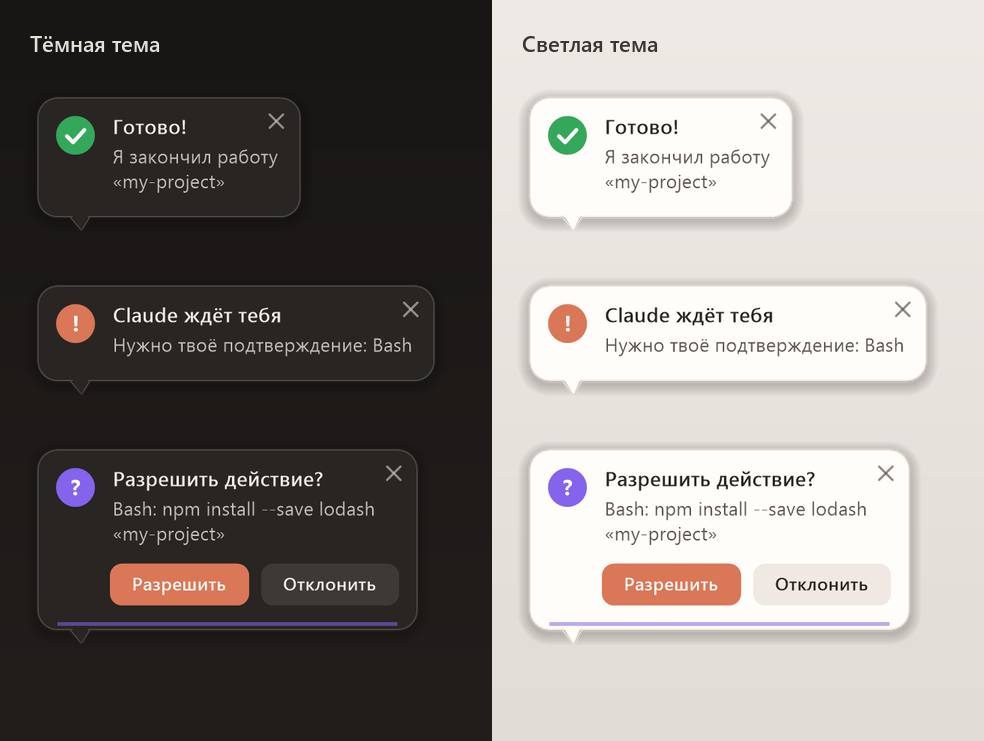
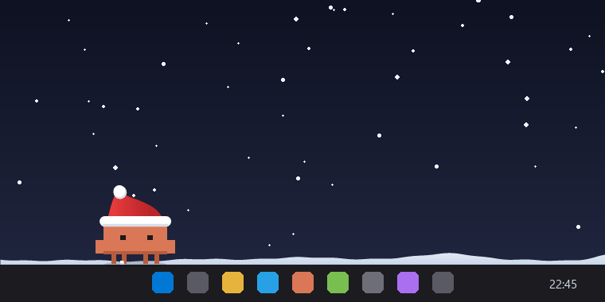

# Clawdling



Маленький пиксельный питомец для Windows, который живёт на панели задач, гуляет по экрану и приносит уведомления от **Claude Code**.

*A tiny pixel desktop pet for Windows that lives on your taskbar, wanders around the screen and pops up with Claude Code notifications. English summary below.*

- Один `.exe` на ~90 КБ, без установки и зависимостей (используется .NET Framework 4.8, который уже есть в Windows 10/11)
- Работает в фоне, ~10 МБ памяти, почти не грузит процессор
- Прячется, когда открыто полноэкранное приложение (игра, видео) на его мониторе

## Возможности

<p align="center"></p>

**Живёт своей жизнью.** Ходит и бегает по панели задач, сидит, засыпает (Zzz), зевает, танцует, машет, думает, следит глазами за курсором. Забирается на края экрана, запрыгивает на окна и катается на них, когда ты их двигаешь. Иногда ныряет в панель задач и выглядывает оттуда.

**Эмоции.** Радость, смех, влюблённость, удивление, грусть со слезой, злость, головокружение со звёздочками, подмигивание, сонливость и т.д.



**Можно трогать.**
- Зажми и перетащи — он болтает лапками; отпусти с размаху — полетит, отскочит от краёв и приземлится
- Клик — радуется, много кликов — злится, двойной клик — танцует
- Правый клик — меню

<p align="center"></p>

**Уведомления Claude Code.**
- Claude закончил работу → Клод выпрыгивает с конфетти и пузырём «Готово!»
- Claude ждёт ответа/подтверждения → подпрыгивает с «!»
- Запрос разрешения → пузырь с кнопками **Разрешить / Отклонить** прямо на рабочем столе (если не ответить за 45 с — откроется обычный диалог Claude Code)



**Новогодний режим** (меню → «Новогодний режим»)
- Красная шапочка с помпоном, которая болтается при движении
- Снег и сугроб на панели задач
- Клод сам лепит снежки из снега на панели задач и кидается ими в курсор или куда попало
- В него можно кидаться: схвати снег с панели задач, кинь движением мыши, или нажми **Ctrl+Alt+S**. Он может увернуться, а если попасть — обязательно ответит!

<p align="center"></p>

## Установка

1. Скачай `Clawdling.exe` из [Releases](../../releases/latest)
2. Положи куда-нибудь насовсем, например в `%LOCALAPPDATA%\Programs\Clawdling\`
3. Запусти. В трее появится значок; там же «Запускать вместе с Windows»

> Windows SmartScreen может предупредить о неизвестном издателе — exe не подписан. «Подробнее» → «Выполнить в любом случае», либо собери сам (см. ниже).

## Подключение к Claude Code

Добавь в `%USERPROFILE%\.claude\settings.json` (путь замени на свой; в меню есть пункт «Подключение к Claude Code → Скопировать настройки хуков», он подставит путь сам):

```json
{
  "hooks": {
    "Stop": [{ "hooks": [{ "type": "command", "command": "\"C:/Users/you/AppData/Local/Programs/Clawdling/Clawdling.exe\" hook" }] }],
    "Notification": [{ "hooks": [{ "type": "command", "command": "\"C:/Users/you/AppData/Local/Programs/Clawdling/Clawdling.exe\" hook" }] }],
    "PermissionRequest": [{ "hooks": [{ "type": "command", "command": "\"C:/Users/you/AppData/Local/Programs/Clawdling/Clawdling.exe\" hook", "timeout": 60 }] }]
  }
}
```

`PermissionRequest` — по желанию: с ним разрешения можно давать кнопкой в пузыре.

Если Clawdling не запущен, хук запустит его сам.

### Командная строка

```
Clawdling.exe notify "текст" "заголовок" done|attn|info   — показать уведомление
Clawdling.exe ask "текст"                                 — спросить; выводит allow / deny / none
Clawdling.exe hook                                        — режим хука Claude Code (JSON на stdin)
```

## Сборка

Нужен только Windows — компилятор C# входит в .NET Framework:

```
build.cmd
```

Готовый файл: `bin\Clawdling.exe`.

Картинки для README генерируются из того же кода отрисовки: `tools\make-assets.cmd` (нужен Python с Pillow).

## English

Clawdling is a lightweight (~90 KB, ~10 MB RAM) desktop pet for Windows 10/11. It walks on the taskbar, climbs screen edges, rides on window title bars, can be dragged and thrown, has a dozen emotions and hides while a fullscreen app is active. Hooked into Claude Code (`Stop`, `Notification`, `PermissionRequest` hooks → `Clawdling.exe hook`) it pops up when Claude finishes, needs your attention or asks for permission (with Allow / Deny buttons). New Year mode adds a Santa hat, snow on the taskbar and snowball fights (grab snow from the taskbar and throw it, or press Ctrl+Alt+S). Build with `build.cmd` (uses the C# compiler that ships with .NET Framework).

---

Неофициальный фанатский проект, не связан с Anthropic. Claude и Claude Code — товарные знаки Anthropic.

Лицензия: [MIT](LICENSE) © 2026 LoaderCode
